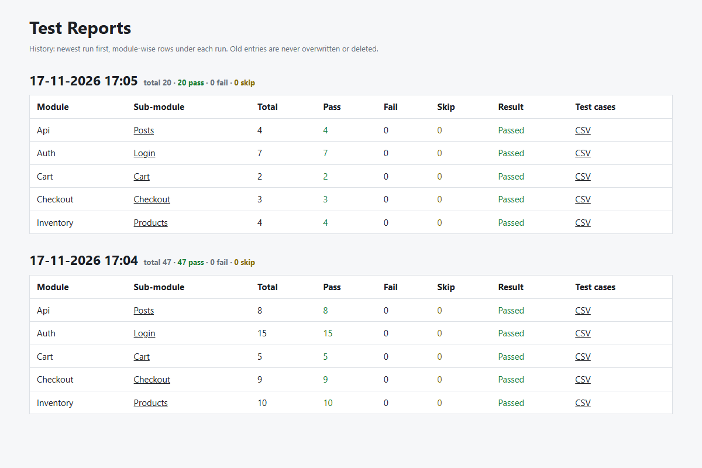
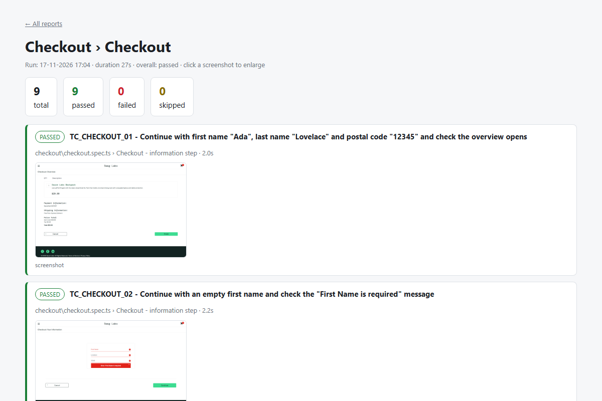

# Playwright Test Automation Framework (TypeScript)

[](https://github.com/allahditasqa/Playwright/actions/workflows/ci.yml)


-brightgreen)

A complete UI and API test automation framework with a **Page Object Model**, module-wise reporting, a managed
regression suite and a documented QA process. The tests run against two public demo services, so you can clone the
repository and run everything yourself in about 30 seconds.

| Target | URL |
| --- | --- |
| Web shop (UI tests) | https://www.saucedemo.com |
| REST API (API tests) | https://jsonplaceholder.typicode.com |

> **Sibling frameworks:** [Cypress](https://github.com/allahditasqa/Cypress) (web) and [Appium](https://github.com/allahditasqa/Appium) (Android + iOS, Java).

---

## What this repository demonstrates

- **Clean architecture:** tests → fixtures → page objects and components → API layer → config, data and utils. Locators live only in page objects.
- **Fast and stable tests:** one login per run (saved session), no hard waits, independent tests, parallel execution.
- **UI and API in one framework:** the same fixtures, reports and process cover both.
- **Reporting that a team can use:** a self-contained HTML report **per module**, named with the run date and time, a **history page** of all runs, and a CSV of the test cases that were about to run.
- **Regression management:** a master CSV of every test case, `smoke` and `regression` runs built from it, and a **traceability check** that fails when documents, CSV and test code disagree.
- **A real QA process:** strategy, test case standard, defect log and **sign-off reports generated from run data**.
- **Quality gates:** TypeScript strict mode, ESLint (with the Playwright plugin), Prettier, and a CI pipeline.

## Tech stack

| Area | Tool |
| --- | --- |
| Test runner | Playwright Test 1.65 |
| Language | TypeScript 6 (strict) |
| Pattern | Page Object Model + reusable components + fixtures |
| Reports | Custom reporter (HTML + CSV + history) and the built-in Playwright HTML report |
| Lint and format | ESLint 10 + `eslint-plugin-playwright`, Prettier |
| CI | GitHub Actions |

## Architecture

```
tests/<module>/<sub>.spec.ts      WHAT to check (steps and assertions only, no locators)
        │ uses
fixtures/test-fixtures.ts         ready objects: loginPage, inventoryPage, cartPage, checkoutPage, postsApi ...
        │ uses
pages/ + components/              HOW to talk to the UI (locators and actions); components are reusable parts (header menu)
api/                              HOW to talk to the REST API (a thin client per resource)
config/ · test-data/ · utils/     environment settings, test users and products, shared constants
        │ runs on
playwright.config.ts              projects: setup · auth · chromium · api (+ firefox, webkit on demand)
reporters/ · scripts/ · docs/     reporting, CSV and sign-off tooling, QA process documents
```

### Design decisions (and why)

| Decision | Why |
| --- | --- |
| Locators only in page objects | A UI change is fixed in one file, never in every test |
| `data-test` attributes via `getByTestId` | Stable against styling and text changes |
| One saved login session (`storageState`) | Only the login tests pay for a real login; the rest start inside the app |
| `auth` project starts logged out, `chromium` project reuses the session | Each test gets exactly the state it needs, nothing leaks between tests |
| Every folder under `tests/` is picked up automatically | Adding a module needs no config change |
| Retries are **off locally**, 1 on CI | A flaky test must be visible on a developer machine, not hidden |
| Titles are full English sentences with the test data | The report reads like a test case; no need to open the code |
| Report file names contain date and time | Old reports are never overwritten, so a run can be compared later |
| Documents are the source of truth, the CSV is generated | One place to edit, and `npm run cases:check` catches drift |

## Project structure

```
.
├── api/                  PostsApi (REST client for JSONPlaceholder)
├── components/           HeaderMenu (burger menu, reusable on every page)
├── config/env.ts         BASE_URL / API_URL, optional TEST_ENV=<name> -> .env.<name>
├── docs/
│   ├── QA_PROCESS.md     life cycle from framework to sign-off
│   ├── TEST_STRATEGY.md  scope, approach, environment, risks, exit criteria
│   ├── TEST_CASE_STANDARD.md
│   ├── test-cases/       one document (.md) and one master CSV per sub-module
│   ├── signoff/          sign-off reports generated from run data
│   └── templates/        defect log and sign-off templates
├── fixtures/             test-fixtures.ts
├── pages/                BasePage, LoginPage, InventoryPage, ProductDetailsPage, CartPage, CheckoutPage
├── reporters/            offline-report.ts (module-wise HTML + CSV with real results, history index)
├── reports/              committed module-wise reports of every run (index.html, history.json, <module>/)
├── scripts/              export-test-cases, run-regression, signoff, open-reports, lib/ (test case + report writer)
├── test-data/            users, products, expected messages
├── tests/                auth · inventory · cart · checkout · api · setup
└── .github/workflows/    ci.yml
```

## Test coverage

| Module | Sub-module | Test cases | Type |
| --- | --- | --- | --- |
| Auth | Login | 15 | UI: valid and invalid login, validation messages, SQL text, access without login |
| Inventory | Products | 10 | UI: list, four sort orders, cart badge, product details |
| Cart | Cart | 5 | UI: add, remove, continue shopping, start checkout |
| Checkout | Checkout | 9 | UI end to end: required fields, order completion, totals = item total + tax |
| API | Posts | 8 | REST: status codes, response shape, filtering, create, update, delete, unknown id |
| **Total** | | **47** | 20 of them are High priority (the smoke suite) |

## Getting started

**Prerequisites:** Node.js 20 or newer.

```bash
git clone https://github.com/allahditasqa/Playwright.git
cd Playwright
npm install
npx playwright install chromium
npm test
```

| Goal | Command |
| --- | --- |
| Run everything | `npm test` |
| Watch the browser | `npm run test:headed` (slow motion: `SLOWMO=300`) |
| Interactive UI mode | `npm run test:ui` |
| One module | `npm run test:auth` · `test:inventory` · `test:cart` · `test:checkout` · `test:api` |
| One test | `npx playwright test -g "TC_LOGIN_03"` |
| **Smoke** (High priority only) | `npm run test:smoke` |
| **Regression** (all cases in the master CSV) | `npm run test:regression` |
| Firefox and WebKit as well | `ALL_BROWSERS=1 npx playwright test --project=firefox --project=webkit` |
| All quality gates | `npm run check` |
| Open the reports history | `npm run reports` |

## Test cases

Every automated case is documented before it is coded, in one standard format (see [docs/TEST_CASE_STANDARD.md](docs/TEST_CASE_STANDARD.md) and [docs/TEST_STRATEGY.md](docs/TEST_STRATEGY.md)).

| Item | Where |
| --- | --- |
| Test case documents (5, one per module) | [`docs/test-cases/*.md`](docs/test-cases) |
| Master CSV (regression list, same columns) | `docs/test-cases/*.csv` |
| Cases | **47**: 20 High, 21 Medium, 6 Low; all automated |

Each case has: **ID** (`TC_<MODULE>_<NN>`, the same ID is in the test title in code), module and sub-module, title, **priority**, **type**
(Functional, Negative, Validation, Boundary, Security, API ...), preconditions, test data, numbered steps, expected result,
automation status and spec file, and the **requirement** it traces to (`REQ-...` in the strategy, or the API guide section).
`npm run cases:check` proves the documents and the code agree 1:1 (IDs, titles, spec files, master CSV); it runs in CI.

## Reports

Every run writes module-wise, self-contained reports (they open without a server). The reports are **committed to the repository**, a new
file for every run, an old report is never overwritten:

```
reports/
├── index.html                                                  history of all runs, newest on top, links to every module report
├── history.json
└── auth/
    ├── Auth test 18-11-2026_12-37-58.html                      HTML report of the module, screenshots embedded
    └── Auth test cases 18-11-2026_12-37-58.csv                 the cases of the module: steps, expected result and the real result of this run
    (the same for inventory/, cart/, checkout/, api/)
```

| Goal | Command |
| --- | --- |
| Generate the reports | `npm test` (the reporter [`reporters/offline-report.ts`](reporters/offline-report.ts) writes them after the run) |
| Open the history | `npm run reports` |

**Latest committed run: 18-11-2026 12:37:58 (47 of 47 passed)**: open [reports/index.html](reports/index.html) or the module reports, for example
[Auth](reports/auth), [Inventory](reports/inventory), [Cart](reports/cart), [Checkout](reports/checkout), [API](reports/api).





## Regression and traceability

- `docs/test-cases/<module>-<sub>.md` is the source of truth. `npm run cases:csv` turns it into a **master CSV**; unchanged rows keep their `Last Updated` date.
- `npm run test:regression` and `npm run test:smoke` build their selection from the master CSV, not from tags in code.
- `npm run cases:check` fails when a document row has no test (or the reverse), an ID appears twice, a title or spec file differs, or the CSV is stale. It also runs in CI.

## Sign-off reports

`npm run signoff -- <module>` writes `docs/signoff/<module> signoff <date>.md` from real run data: results per sub-module,
the High-priority check, the exit criteria, the defect log and a recommendation (**Signed off**, **Conditional** or **Not signed off**).
See [docs/signoff](docs/signoff) for the five generated reports and [docs/QA_PROCESS.md](docs/QA_PROCESS.md) for the rules.

## Sample: how a test reads

```ts
test('TC_LOGIN_08 - Login with username "standard_user" and the wrong password "wrong_password"', async ({
  page,
  loginPage,
}) => {
  await loginPage.login(USERS.standard, 'wrong_password');
  await loginPage.expectError(MESSAGES.badCredentials);
  await expect(page).toHaveURL(ROUTE.login);
});
```

```ts
// pages/LoginPage.ts: locators and actions live here, not in the test
readonly usernameInput = this.page.getByTestId('username');
async login(username: string, password: string) {
  await this.usernameInput.fill(username);
  await this.passwordInput.fill(password);
  await this.loginButton.click();
}
```

## CI

[`.github/workflows/ci.yml`](.github/workflows/ci.yml) runs on every push and pull request:

1. **Quality gates:** type check, lint, format check, traceability check, `playwright test --list`.
2. **UI + API tests** on a clean Linux runner; the reports are uploaded as an artifact.

## Roadmap

- JSON schema validation for API responses
- Visual comparison for the products page
- Accessibility checks with axe
- Allure or Playwright blob reports merged across shards
